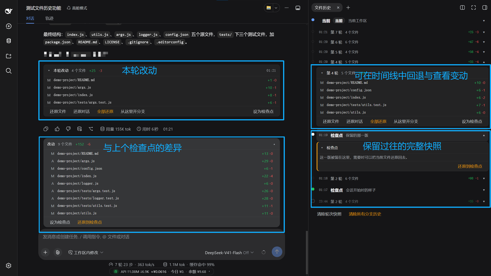
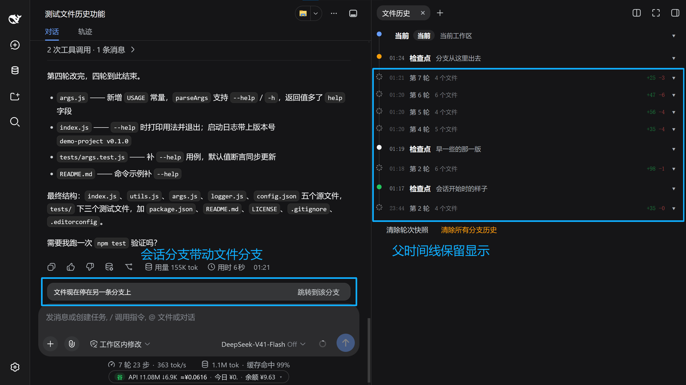

# dsh-file-history

每一轮对话改过的文件列在回复下面，不满意就还原到改动之前。

装进 [DeepSeek Harness](https://github.com/deepseek-ai/deepseek-harness) 之后，AI 每回应一次，插件把这一轮改过的文件整理成卡片贴在该回复下方：改了哪些文件、增删多少行，点文件名看 diff，点按钮还原。

## 它做什么

每一轮对话结束，插件把整个工作区拍一张快照。不是只记 AI 调用过的那次写入，而是这一轮前后磁盘上真实的样子——AI 用脚本绕过去改的文件同样在里面。快照存在 `~/.dsh/file-history/` 下，不进你的项目目录，也不经过你的 git：项目里没有 `.git` 一样能用，有也不会被读写。

于是每条真正改了文件的回复下面多一张卡片：这一轮动了哪些文件、各增删多少行，点文件名看这一轮具体改了什么。最下面四个按钮——只还原文件、只还原对话、两者一起还原、从这一轮开个分支。还原就是拿回这一轮开始前的内容，改错了当没说；还原本身也能撤销。侧栏另有一条时间线，把每轮和你手动标的检查点排在一起，可以跳到任意一个退回去；输入框上方只在工作区跟你标的检查点有差异时出现一条，写明差多少，一键退回。

用的东西不陌生：VS Code 侧边栏那个「时间线」按时间列出同一个文件被改过的每个版本，随时退回去。这插件做的是同一件事，只是单位从「一次保存」换成「一轮对话」，退的时候可以连对话一起退，整件事都在对话框里做完，不用切到编辑器、不用翻 git 日志。

它不做代码审查，也不替代 git：项目里的提交、分支、暂存区一概不碰。

## 安装

```bash
dsh plugin --profile web add dsh-file-history
```

装完重启 DSH。卸载：

```bash
dsh plugin --profile web remove dsh-file-history
```

需要 DSH 0.1.x、Node.js ≥ 20、git ≥ 2.20。git 不在 PATH 里时用配置项 `gitPath` 或环境变量 `DSH_FILE_HISTORY_GIT` 指定绝对路径。工作区不必是 git 仓库：插件自带存储，不读也不写项目里的 `.git`。找不到 git 时不阻断对话，卡片上显示一行不可用提示。

## 界面



**对话下方**：每条真正改动了文件的回复下面一张卡片，含文件列表（新增 / 修改 / 删除）、增删行数、被跳过的大文件数量。点文件名展开 diff；底部四颗按钮——只还原文件、只还原对话、全部还原、从这里开分支；还原后出现「撤销还原」。没改动的轮次不出卡片。

**侧栏**：「文件历史」页是一条时间线，倒序排列：顶部固定一行「现在」（磁盘现状），往下是检查点，再往下是各轮。点任意一行展开详情和还原入口。检查点的圆点颜色标出它的来路（会话开头绿、分叉琥珀、手动标的深色）；属于父分支的轮次整个压暗、圆点外套一圈虚线，四颗操作按钮灰着，只能看。

**输入框上方**：已有检查点且工作区与它有差异时，出现一条改动条，写明差了多少文件、增删多少行，展开是逐个文件，底部是「还原到检查点」。无检查点或无差异时完全不出现。工作区只有一份文件，若同一条线的另一条分支比本线更晚改过它，改动条上方多出一张小卡「文件现在停在另一条分支上」，点「跳转到该分支」切到那个会话。

## 还原

| 操作 | 磁盘文件 | 对话 |
| --- | --- | --- |
| 只还原文件 | 写回该轮开始前的内容 | 不动 |
| 只还原对话 | 不动 | 从该轮之前分叉出新会话，原会话保留 |
| 全部还原 | 写回该轮开始前的内容 | 分叉出新会话并切过去 |
手动改的文件不计入历史，还原时会被快照覆盖。所以真要盖之前会先看一眼：记录之后磁盘上被外面改过的文件有几个，先问一句「仍要覆盖？」——答了才动，取消就一个字节都不写。开分支同样会把磁盘拉到那一版，一样先问。
手动改的文件不计入历史，还原时会被快照覆盖。

「从这里开分支」把文件摆回那一轮结束时的样子，再看一个新会话接上去，原会话和它之后的轮次一条都不删。时间线上属于父分支的轮次是只读的，四颗按钮都灰着——要动那条线，先用改动条上方那张卡跳过去。



## 检查点

侧栏或卡片上点「设为检查点」存下当前文件树。此后输入框上方的改动条持续显示工作区与该检查点的差异，点「还原到检查点」退回。检查点跟着会话线走，从同一会话分叉出去的会话共用一条；还原后仍可撤销。

检查点有三种来路：会话开头自动记一个、从某轮分叉时记一个、手动标的。它们进同一条时间线，地位一样，都能还原。分支会话的时间线从它自己往上接——父分支在分叉那一刻之前的轮次与检查点都在，父分支后来另走的路和兄弟分支不在。自动裁剪按分支各算各的：一条线保留自己的最近 `keepRecentTurns` 轮，并在它这一族够 `pruneAfterCheckpoints` 个检查点时以倒数第 N 个为切点。

裁剪只在标检查点那一刻发生，所以也在那一刻说：点完「设为检查点」，如果顺手清掉了更早的轮次，提示里会多一句「已清理更早的 N 轮」——轮次不会无声消失。

侧栏时间线底部是这一条会话自己的设置，跟着会话走，不跟着工作区走：第一次拍快照时从插件配置拷一份，之后各管各的；从这条线分出来的会话会带上父会话那一份。五行从常用往下排：

- 「对此会话启用文件历史」默认开着。关掉就是这条会话整件事都停了：不扫盘、不拍快照、不算差异、也设不了新检查点，输入框上方那条不再出现；已经记下来的轮次和检查点照旧在列表里，能看也能还原。从这条线开出来的分支会带上父会话那份设置，包括这个开关。
- 「每轮自动拍快照」也默认开着。关掉之后只在点「设为检查点」时记录，代价是没有逐轮的卡片和时间线行，只能还原到检查点。
- 「保留最近轮次」是这一支留多少轮，0 表示不裁。只有族根那条线能改，子会话不显示这一行——留几轮是整支一起算的。
- 「排除规则」一行一条路径，改完点保存才生效，只影响这一条会话。被排除的路径从下一次拍快照起就不再记录，之前记过的也不会再出现在改动和还原里——记录与比较用的是同一份范围，规则说不管它就真的不管它。
- 「允许规则」同样一行一条。空着就是全记（现在的行为）；填了就只记这里列出的路径，排除规则仍然在里面继续生效。给「只想盯住几个文件」的会话用。

这几行下面还有一行只读的「占用空间」：这个工作区记下的快照与账本一共占多少，一个快照都没有时不显示。

最下面两个清理入口：「清除轮次快照」只抹掉逐轮的记录，根节点与分支节点留下，时间线骨架不变；「清除所有分支历史」连检查点一起清，回到刚装插件的样子。两者都作用于当前这条会话线的所有分支，并行的其他会话线不受影响。

## 配置

写在 profile 的 `cordis.patch.yml` 里，示例见 `config.example.yml`。这些值也能在**设置 → 插件 → 文件历史**里直接改：三个界面开关和几个数量上限都在那一张卡里，改完下一轮就生效，不用重启。

```yaml
- insert:
    - id: file-history
      name: 'dsh-file-history'
      config:
        gitPath: ''            # 留空则在 PATH 里找 git
        excludes: []           # 追加在默认排除清单之后
        maxFileBytes: 5242880  # 超过此大小的文件整块不记
        maxEntries: 100        # 保留最近多少轮
        pruneAfterCheckpoints: 2   # 自动裁剪到倒数第几个检查点
        keepRecentTurns: 20        # 检查点不够上面这个数时保留最近多少轮
        maxDirFiles: 20000         # 单个目录超过这么多文件就整块不记
        maxRepoFiles: 20000        # 自带 .git 的目录超过这么多文件就整块不记
        maxBytes: 2147483648       # 整个工作区的记录上限（2 GB）
```

## 数据

全部在 `$DSH_HOME/file-history/`（默认 `~/.dsh`）下，项目目录零残留，不外传。内容相同的文件只存一份；超出保留轮数的旧记录连同对象一并回收。

这不是永不丢失的记录工具：手动删掉 `file-history/` 下对应目录后，插件按全新工作区重建，之前的历史不再找回；父会话的账本已经不在了，新分支就不再往上接。

默认不记录 `node_modules`、`.git`、`dist`、`build`、`.venv` 这类目录，以及单个超过 5 MB 的文件；大文件变小后会重新记录。

工作区里自带 `.git` 的目录按文件记录，不是只记一个「这里有个仓库」的指针——里面改了、加了、删了都能看到。列文件用的是那个仓库自己的忽略规则，它的 `node_modules` 和产物同样不会进来。第一次遇到时文件数就超过 `maxRepoFiles` 的仓库整块不记，那一轮的卡片上会点名是哪几个目录。

## 已知限制

- 只跟随会话的工作目录，不跨盘、不扫全盘
- 符号链接按普通文件处理
- 插件装上之前的改动不在历史里
- 侧栏面板不自动弹出，需自己打开
- 与 `dsh-better-sidebar` 的「本轮产出文件」共用同一位置，同时安装时以本卡片为准；不装它不影响本插件

## 开发

无构建步骤：`lib/index.js` 是服务端 ESM，`lib/client.js` 是浏览器端成品 bundle。设计见 `DESIGN.md`。

纯解析与合并规则在 `lib/parse.js`，不碰 git 也不碰文件，直接用 `node --test` 验：`npm test`。
