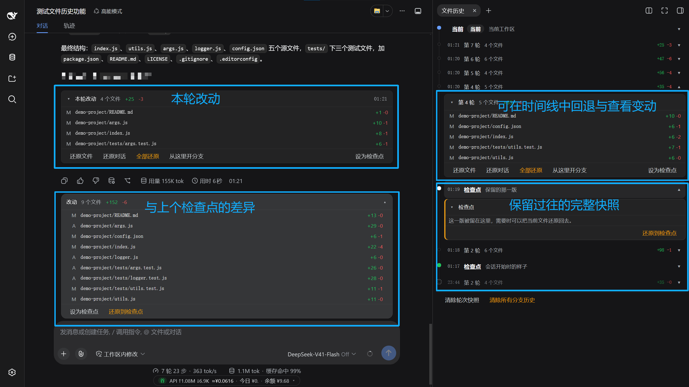
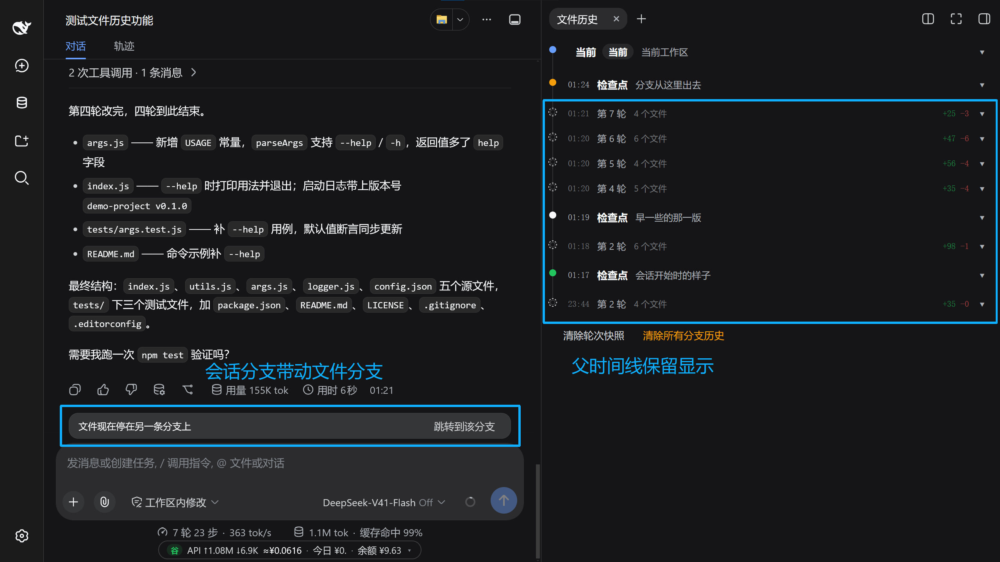

# dsh-file-history

**让 DSH 的每一轮对话，都有一个可以回去的版本。**

用 DSH 写代码，有时候会遇到这样的情况：AI 改了一堆文件，结果不太对劲，想退回上一轮。DSH 可以帮你恢复对话，却不会把文件也恢复；Git 虽然能管文件，但 AI 一轮对话可能涉及好几个文件，改动又和你自己的修改混在一起，很难准确地只撤销这一轮。

`dsh-file-history` 就是为了解决这个问题做的。

它会在每轮对话结束后记录整个工作区的文件状态，并将这份记录与对应的对话关联起来。这样，你不必再费心区分哪些文件是 AI 改的、哪些改动属于哪一轮。想回到某个时间点，就把文件和对话一起带回去。

## 用起来是什么样的

- **每轮对话自动留档。** 对话结束后，插件会扫描整个工作区，将当前文件状态保存为一份快照。所有快照都放在 `~/.dsh/dsh-file-history/` 下的独立 Git 仓库中，与项目自身的 Git 仓库完全分开。即使项目没有初始化 Git，也可以正常使用。

- **改了什么，一眼就能看到。** 如果这一轮确实修改了文件，回复下方就会出现一张改动卡片，列出涉及的文件，以及每个文件增删的行数。点击文件名可以查看具体 diff。卡片底部还有一排按钮：还原文件到此处、还原会话到此处、还原文件和会话、撤销此轮更改、从此处分支。

- **所有历史都在一条时间线上。** 右侧边栏新增了「文件历史」面板，按时间倒序排列每一轮对话和你手动创建的检查点。选中任意一条记录，就可以将工作区恢复到当时的状态。输入框上方还会显示一条改动提示，告诉你当前工作区相对于最近检查点改了多少文件、增删了多少行。

- **退错了还能往前退一步。** 最末一条记录上有一颗「撤销此轮更改」，把这一轮带来的改动整批退回去；还原之前如果外面手改过文件，会先问你一句再覆盖。

如果你熟悉 VS Code 的 Timeline（时间线）功能，应该很容易理解它的设计：VS Code 记录的是单个文件每次保存的历史，而 `dsh-file-history` 把这个思路扩展到了整个工作区，记录的单位不再是一次保存，而是一次完整的 DSH 对话。

## 我在意的不只是能不能还原

文件历史最怕的不是少一个功能，而是你真正需要恢复的时候，才发现记录不完整，或者一次还原反而覆盖了其他工作。

所以在实现时，我也专门处理了这些容易被忽略的问题：

- **记录以实际文件为准。** 插件直接扫描磁盘上的文件内容，而不是依赖 AI 汇报自己修改了什么。因此，无论是 AI 通过脚本写入的文件，还是你在编辑器里手动做的修改，只要符合记录范围，都会被纳入快照。

- **不会不声不响地覆盖新改动。** 在恢复工作区之前，插件会检查目标版本之后是否还有其他文件被修改。如果检测到冲突，会先询问你是否仍要覆盖。选择取消，就不会写入任何文件。

- **尽量减少历史记录的占用。** 底层使用 Git 存储快照，相同的文件内容只保存一份；过期历史及其关联对象也会一并清理。占用空间可以直接在侧边栏查看，不用猜插件究竟存了多少东西。

- **记录范围有明确限制。** 单个文件、单个目录以及嵌套 Git 仓库都有各自的处理上限。遇到超限对象时，插件会跳过并在改动卡片中明确列出，而不是假装一切都已成功记录。

- **不干涉你原本的 Git 工作流。** 插件使用独立仓库存储历史，不会修改项目自己的 `.git`，也不会碰项目的暂存区、提交和分支操作。它负责文件历史，不负责代码审查，也不试图替代 Git。

我做这个插件的初衷很简单：**既然 DSH 已经能记住我们和 AI 讨论过什么，那它也应该能记住 AI 当时把文件改成了什么样。**

不管是 AI 改坏了代码，想回到上一轮；还是想找回几天前某个能正常运行的版本，都不应该再靠手动备份、翻 Git 记录或者祈祷自己记得当时改了什么。

希望它能让你用 DSH 写代码时，多一点放心，少一点顾虑。

## 安装

```bash
dsh plugin --profile web add dsh-file-history
```

装完重启 DSH。卸载：

```bash
dsh plugin --profile web remove dsh-file-history
```

需要 DSH ≥ 0.1.7-rc.2 且 < 0.3.0、Node.js ≥ 20、git ≥ 2.20。0.1.5 那一代用 0.3.x 的旧版本。git 不在 PATH 里时用配置项 `gitPath` 或环境变量 `DSH_FILE_HISTORY_GIT` 指定绝对路径。工作区不必是 git 仓库：插件自带存储，不读也不写项目里的 `.git`。找不到 git 时不阻断对话，卡片上显示一行不可用提示。

## 界面



**对话下方**：改动清单由 DSH 官方那一行列出（文件名、增删行数、点开看 diff），插件在它下面补一行按钮——还原文件到此处、还原会话到此处、还原文件和会话、撤销此轮更改、从此处分支。撤销只出现在最末一条记录上：它后面没有别的轮次，退回去不会跨过谁。没改动的轮次两个都不出现。

每条回复下方的动作按钮只在那一轮真有文件历史时出现：有快照给整套；有扫过但没改动的，只给「设为检查点」；没扫过的（自动拍快照关着），一颗都不给。

**侧栏**：「文件历史」页是一条时间线，倒序排列：顶部固定一行「现在」（磁盘现状），往下是检查点，再往下是各轮。点任意一行展开详情和还原入口。检查点的圆点颜色标出它的来路（会话开头绿、分叉琥珀、手动标的深色）；属于父分支的轮次整个压暗、圆点外套一圈虚线，四颗操作按钮灰着，只能看。

**输入框上方**：已有检查点且工作区与它有差异时，出现一条改动条，写明差了多少文件、增删多少行，展开是逐个文件，底部是「设为新的检查点」和「还原到上个检查点」——后者还原的就是那一条上写的检查点，不是它之前的版本。没有检查点或没有差异时完全不出现。工作区只有一份文件，若同一条线的另一条分支比本线更晚改过它，改动条上方多出一张小卡「文件现在停在另一条分支上」，点「跳转到该分支」切到那个会话。

## 还原

| 操作 | 磁盘文件 | 对话 |
| --- | --- | --- |
| 还原文件到此处 | 写回这一轮结束时的状态 | 不动 |
| 还原会话到此处 | 不动 | 从该轮之后分叉出新会话，原会话保留 |
| 还原文件和会话 | 写回这一轮结束时的状态 | 分叉出新会话并切过去，原会话归档（侧栏里只留回来这一条） |
| 撤销此轮更改 | 退回这一轮开始前的状态（两轮之间的手改留着） | 不动 |
手动改的文件不计入历史，还原时会被快照覆盖。所以真要盖之前会先看一眼：记录之后磁盘上被外面改过的文件有几个，先问一句「仍要覆盖？」——答了才动，取消就一个字节都不写。开分支同样会把磁盘拉到那一版，一样先问。

「从这里开分支」把文件摆回那一轮结束时的样子，再看一个新会话接上去，原会话和它之后的轮次一条都不删。时间线上属于父分支的轮次是只读的，一整排按钮都灰着——要动那条线，先用改动条上方那张卡跳过去。



## 检查点

侧栏、卡片或改动条上点「设为检查点」存下当前文件树。一条文件历史只对应一个轮次：在某一轮上设点之后，快照换成检查点，卡片和别的轮次长得一模一样——同样的文件清单、同样的还原文件到此处／还原会话到此处／还原文件和会话／撤销此轮更改／从此处分支，只有最后一颗换成「删除检查点」；时间线上由检查点那一行代表它、不会出现两条；没有改动时设点，会把往前能溯源的最近一份快照复制到这一轮；如果往前根本找不到文件历史（比如自动拍快照一直关着），会提示没法设。删除检查点会把它还原成普通快照，那一轮的记录不会丢。对话里那一轮下方的卡片和右侧时间线上的那一行给的是同一套按钮，时间线只是同一份记录的缩影。此后改动条持续显示工作区与该检查点的差异，点「还原到上个检查点」就把磁盘拉回那一版，是那个时间点，不是它之前。检查点跟着会话线走，从同一会话分叉出去的会话共用一条；还原后仍可撤销。

检查点有三种来路：会话开头自动记一个、从某轮分叉时记一个、手动标的。它们进同一条时间线，地位一样，都能还原。分支会话的时间线从它自己往上接——父分支在分叉那一刻之前的轮次与检查点都在，父分支后来另走的路和兄弟分支不在。自动裁剪按分支各算各的：一条线保留自己的最近 `keepRecentTurns` 轮，并在它这一族够 `pruneAfterCheckpoints` 个检查点时以倒数第 N 个为切点。

裁剪只在标检查点那一刻发生，所以也在那一刻说：点完「设为检查点」，如果顺手清掉了更早的轮次，提示里会多一句「已清理更早的 N 轮」——轮次不会无声消失。

侧栏时间线底部是这一条会话自己的设置，跟着会话走，不跟着工作区走：第一次拍快照时从插件配置拷一份，之后各管各的；从这条线分出来的会话会带上父会话那一份。五行从常用往下排：

- 「对整棵会话树启用文件历史」默认开着。关掉管的是整棵树——同一棵树里分出来的每条会话一起停：不扫盘、不拍快照、不算差异、也设不了新检查点，输入框上方那条不再出现；已经记下来的轮次和检查点照旧在列表里，能看也能还原。开关写在树根上，从任何一支关掉，整棵树都关。
- 「每轮自动拍快照」也默认开着。关掉之后只在点「设为检查点」时记录，代价是没有逐轮的卡片和时间线行，只能还原到检查点。
- 「检查点后清理到」是这棵树凑够这么多个检查点时，把倒数第 N 个之前的轮次删掉；0 表示不按检查点裁。
- 「保留最近轮次」是最近多少轮一定留着，0 表示不按轮次裁。它和上一条同时生效：两个条件都满足才留下，早于切点的轮次就算很新也删。两项都按整棵树算，树里哪条会话都能改，改的是同一个值。
- 「排除规则」一行一条路径，改完点保存才生效，只影响这一条会话。被排除的路径从下一次拍快照起就不再记录，之前记过的也不会再出现在改动和还原里——记录与比较用的是同一份范围，规则说不管它就真的不管它。
- 「允许规则」同样一行一条。空着就是全记（现在的行为）；填了就只记这里列出的路径，排除规则仍然在里面继续生效。给「只想盯住几个文件」的会话用。

这几行下面还有一行只读的「占用空间」：这一棵树的提交与检查点能走到的对象一共占多少，一个快照都没有时不显示。下面的两个清理入口也只动这一棵树。

最下面两个清理入口：「清除轮次快照」只抹掉逐轮的记录，根节点与分支节点留下，时间线骨架不变；「清除所有分支历史」连检查点一起清，回到刚装插件的样子。两者都作用于当前这条会话线的所有分支，并行的其他会话线不受影响。

## 配置

写在 profile 的 `cordis.patch.yml` 里，示例见 `config.example.yml`。这些值也能在**设置 → 插件 → 文件历史**（插件页里的一个 tab）里直接改：三个界面开关和几个数量上限都在那一页，改完下一轮就生效，不用重启。

```yaml
- insert:
    - id: file-history
      name: 'dsh-file-history'
      config:
        gitPath: ''            # 留空则在 PATH 里找 git
        excludes: []           # 追加在默认排除清单之后
        maxFileBytes: 5242880  # 超过此大小的文件整块不记
        maxEntries: 100        # 保留最近多少轮
        pruneAfterCheckpoints: 2   # 自动裁剪到倒数第几个检查点
        keepRecentTurns: 20        # 检查点不够上面这个数时保留最近多少轮
        maxDirFiles: 20000         # 单个目录超过这么多文件就整块不记
        maxRepoFiles: 20000        # 自带 .git 的目录超过这么多文件就整块不记
        maxBytes: 2147483648       # 整个工作区的记录上限（2 GB）
```

## 数据

全部在 `$DSH_HOME/dsh-file-history/`（默认 `~/.dsh`）下，项目目录零残留，不外传。内容相同的文件只存一份；超出保留轮数的旧记录连同对象一并回收。

这不是永不丢失的记录工具：手动删掉 `dsh-file-history/` 下对应目录后，插件按全新工作区重建，之前的历史不再找回；父会话的账本已经不在了，新分支就不再往上接。

默认不记录 `node_modules`、`.git`、`dist`、`build`、`.venv` 这类目录，以及单个超过 5 MB 的文件；大文件变小后会重新记录。

工作区里自带 `.git` 的目录按文件记录，不是只记一个「这里有个仓库」的指针——里面改了、加了、删了都能看到。列文件用的是那个仓库自己的忽略规则，它的 `node_modules` 和产物同样不会进来。第一次遇到时文件数就超过 `maxRepoFiles` 的仓库整块不记，那一轮的卡片上会点名是哪几个目录。

## 已知限制

- 只跟随会话的工作目录，不跨盘、不扫全盘
- 符号链接按普通文件处理
- 插件装上之前的改动不在历史里
- 侧栏面板不自动弹出，需自己打开
- 0.4.0 起只支持 DSH ≥ 0.1.7-rc.2；0.1.5 一系留在 0.3.x
- 轮次下方的文件清单与 diff 用的是 DSH 官方那一份，会话重启后官方只留文件名、不再给 diff，插件这边仍可还原到任意一轮

## 遇到问题

插件还很新，一个人维护，覆盖面有限，上面这些只是我已经知道的。遇到没写到的报错、卡住，或者实际行为和文档不一致，请一定告诉我：QQ 2522944131，也可以在本仓库开 issue。附上操作步骤、报错原文和 DSH 版本即可，方便的话再贴一份 `~/.dsh/dsh-file-history/` 下对应目录的 `index.json`。

## 开发

无构建步骤：`lib/client.js` 是浏览器端成品 bundle，其余是服务端 ESM，按职责分文件：

- `lib/index.js`：入口。注册热更新、会话事件与 RPC 通道，别的都不做。
- `lib/history.js`：会话侧。把 `turn/start`/`turn/end` 变成快照，处理客户端发来的各端点。
- `lib/workspace.js`：一个工作区的账本与影子仓库——扫描、树与提交、检查点、裁剪、还原、占用。
- `lib/git.js`：git 进程封装与版本探测。
- `lib/config.js`：默认值、设置页的 schema、账本路径。
- `lib/parse.js`：纯解析与合并规则，不碰 git 也不碰文件，`npm test` 验的就是它。

设计见 `DESIGN.md`，每个版本改了什么见 `CHANGELOG.md`。
